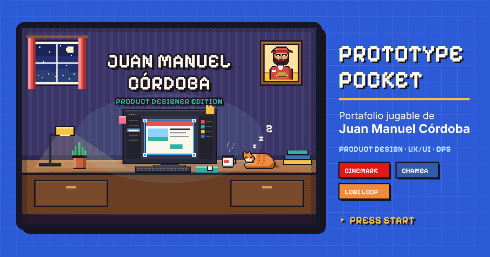

# PROTOTYPE POCKET · Portafolio de Juan Manuel Córdoba



**Juégalo aquí: https://juanmaco.github.io/portafolio/**

Portafolio de Lead Product Designer (UX/UI, Product Design y Ops) convertido en un juego de consola portátil en pixel art: el profesor presenta mi recorrido y en el laboratorio eliges entre las cápsulas con los casos de estudio de **Chamba** y **Logi Loop** (**Cinemark**, próximamente).

- Sitio estático, sin dependencias: HTML, CSS y JavaScript.
- Arte pixel original (generado como SVG) y música chiptune hecha con Web Audio.
- Versión horizontal tipo emulador en el móvil y un **modo clásico** para leer los casos sin jugar.
- En español e inglés (botón ES / EN; abre según el idioma del navegador o con `?lang=en`), con CV descargable en cada idioma.

Para verlo en local: `powershell -ExecutionPolicy Bypass -File servidor.ps1` y abrir http://localhost:8080

## Publicar cambios

Antes de cada commit, actualiza la versión de los archivos en `index.html` para que los navegadores no usen la copia vieja (GitHub Pages guarda en caché 10 minutos):

```bash
V=$(date +%Y%m%d%H%M); sed -i -E "s#(css/estilo.css|js/[a-z_]+.js)(\?v=[0-9]+)?\"#\1?v=$V\"#g" index.html
```
